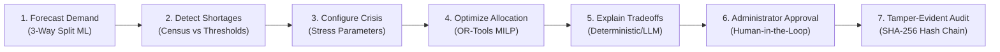
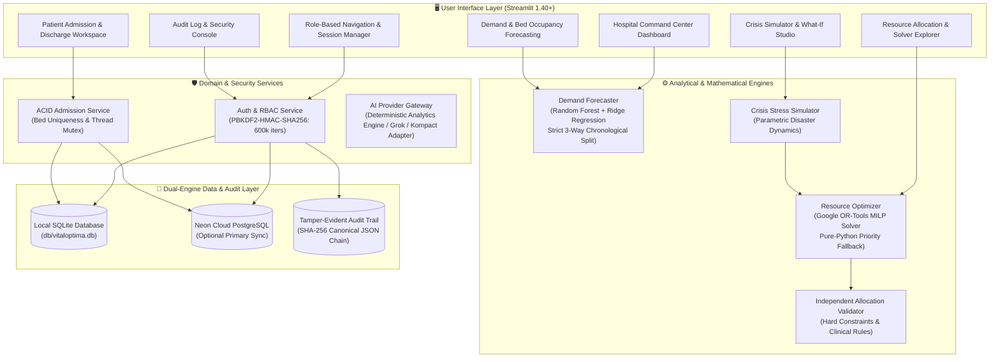

# VitalOptima

### AI-Assisted Hospital Operations Intelligence & Resource Optimization

VitalOptima combines demand forecasting, constrained resource optimization, emergency scenario simulation, and human-reviewed operational recommendations to help hospital administrators understand and evaluate resource shortages.

---

[](https://python.org)
[](https://streamlit.io)
[](https://scikit-learn.org)
[](https://developers.google.com/optimization)
[](#database-safety--dual-engine-architecture)
[](#automated-testing--verification)
[](LICENSE)

---

## Table of Contents
- [Project Overview](#project-overview)
- [How VitalOptima Works](#how-vitaloptima-works)
- [System Architecture](#system-architecture)
- [Core Features](#core-features)
- [Empirical Forecast Evaluation](#empirical-forecast-evaluation)
- [Quick Start Guide](#quick-start-guide)
- [Flagship Demo: Hospital Emergency Surge](#flagship-demo-hospital-emergency-surge)
- [Database Safety & Dual-Engine Architecture](#database-safety--dual-engine-architecture)
- [Security & Tamper-Evident Audit Trail](#security--tamper-evident-audit-trail)
- [Automated Testing & Verification](#automated-testing--verification)
- [Clinical & Responsible-Use Disclosures](#clinical--responsible-use-disclosures)
- [Documentation Links](#documentation-links)

---

## Project Overview

Tertiary hospitals and trauma centers operate under stochastic pressure where patient influx, bed capacity, staffing ratios, and medical supplies fluctuate continuously. During high-demand periods—such as seasonal respiratory epidemics, mass casualty trauma incidents, or sudden nursing absenteeism—administrative delays in resource reallocation cause emergency boarding, delayed care, and staff burnout.

### The Problem vs. The Solution
* **The Forecasting Challenge:** Predicting future hospital arrivals is distinct from optimizing resources. Naive projections often suffer from future-target data leakage and understate operational variance during crisis surges.
* **The Optimization Challenge:** Operational shortages cannot be solved by simply hoping for more beds. Mathematical reallocation must satisfy hard clinical compatibility constraints, respect licensed department ceilings, and make remaining shortages transparent.
* **The VitalOptima Solution:** An administrative decision-support platform designed to give clinical leaders forward-looking situational awareness. VitalOptima pairs a leakage-free machine learning forecaster with a Google OR-Tools Mixed-Integer Linear Program (MILP) solver and an interactive crisis simulator, producing transparent, human-reviewed operational recommendations.

> **Operational Decision Support Boundary:**  
> VitalOptima is strictly an administrative and logistical decision-support system. It **does not** perform autonomous clinical diagnoses, prescribe therapy, or make triage decisions. All optimization proposals require human administrator review and authorization.

---

## How VitalOptima Works

VitalOptima links predictive telemetry, scenario modeling, mathematical optimization, and administrative sign-off into a closed-loop 7-step workflow:



1. **Forecast Expected Demand:** Fits non-leaky autoregressive features on daily hospital census telemetry to forecast forward patient volume.
2. **Identify Possible Shortages:** Evaluates projected arrivals against departmental staffing and staffed bed capacity ceilings.
3. **Configure an Emergency Scenario:** Applies validated disaster parameters (surge percentage, damaged ICU beds, staff absenteeism) in the crisis simulator.
4. **Optimize Resource Allocation:** Google OR-Tools MILP formulates optimal patient-to-department assignments enforcing hard capacity and clinical compatibility constraints.
5. **Explain Remaining Shortages:** Transparently reports binding constraints, saturated units, and unmet patient demand.
6. **Obtain Administrator Approval:** The authorized administrator reviews the proposed reallocation, modifies parameters if needed, and signs off.
7. **Record Decision in Audit Trail:** Records the operational decision into a cryptographically linked, append-only SHA-256 audit log.

---

## System Architecture



---

## Core Features

### 1. Forecasting Intelligence
* **Leakage-Free Feature Engineering:** All autoregressive lags (`lag_1`, `lag_7`) and rolling statistics are calculated strictly on shifted series (`shift(1)`). Warmup rows are dropped to eliminate backward-filling (`bfill`) leakage.
* **3-Way Chronological Partition:** Strict separation into Training (70% / 250 days), Calibration (15% / 53 days), and Untouched Test (15% / 55 days) periods.
* **Calibrated Prediction Intervals:** Residual quantiles are estimated exclusively on the held-out calibration set and evaluated on the untouched test split.
* **Derived Diurnal Hourly Distribution:** Distinguishes genuine daily telemetry forecasts from illustrative hourly profiles derived using circadian diurnal weights.

### 2. Constraint-Aware Resource Optimization
* **Mathematical Formulation:** Formulated as a Mixed-Integer Linear Program (MILP) solved via Google OR-Tools (`CBC` / `SCIP` / `GLOP`).
* **Hard Constraints Enforced:**
  - Physical bed capacity limits per clinical department.
  - Clinical compatibility matrix (e.g., critical care patients strictly routed to ICU; pediatric patients strictly routed to Pediatrics).
  - Non-negative integer allocation variables.
* **Soft Acuity Penalties:** Acuity-weighted penalties prioritize high-acuity patients (ICU: 1000, Trauma: 800) over lower-acuity units, while transfer penalties discourage unnecessary cross-department boarding.
* **Slack Unmet-Demand Modeling:** When demand exceeds physical hospital capacity, slack variables absorb excess influx, ensuring solver feasibility while explicitly reporting unallocated patients as shortages.
* **Pure-Python Priority Fallback:** If OS security policies (e.g., Windows Defender Application Control / AppLocker) restrict C++ solver DLL loading, the optimizer automatically switches to an exact priority-constrained linear fallback that satisfies identical hard constraints.
* **Independent Validator:** `validate_allocation()` validates returned solutions against physical capacity and compatibility rules independently of the solver's internal objective score.

### 3. Emergency Scenario Simulation
* **Parametric Crisis Shocks:** Simulates mass-casualty trauma arrivals (+85% surge), infectious disease waves (+60% surge), ICU bio-contamination (10 damaged beds), or nursing strikes (35% absenteeism).
* **Coupled Optimization:** Feeds the shocked hospital state directly into the optimizer to compute mathematically feasible reallocations.
* **Truthful Before-and-After Comparisons:** Computes baseline and mitigated metrics from identical scenario states, reporting resolved allocations, binding bottlenecks, and remaining unmet patient demand.

### 4. Admission Management & Concurrency Safety
* **ACID Invariants:** Patient admission, bed allocation, and department capacity recalculation execute within atomic database transactions.
* **Partial Unique Index:** SQLite and PostgreSQL schemas enforce `idx_active_bed_occupancy` (`UNIQUE (bed_number) WHERE status = 'Admitted'`), preventing simultaneous double allocation of the same bed across concurrent sessions.
* **Idempotency Protection:** Admission request keys prevent duplicate patient registrations from repeated form submissions.
* **Safe Discharge Workflow:** Discharging a patient frees their bed, increments available departmental capacity, and logs the discharge event.

### 5. Evidence-Grounded AI Architecture
* **Calculations Outside the Model:** Forecasts, allocations, and scenario outcomes are computed exclusively by deterministic mathematical engines. The language model only interprets and explains structured analytical results.
* **100% Offline Deterministic Fallback:** Operates with full functionality without external API keys or network access via `DeterministicProvider`.
* **xAI Grok Integration:** Optional external LLM integration via OpenAI-compatible endpoints with allowlisted read-only analytical tool execution.
* **Future Kompact Scaffold:** `KompactAdapter` provides an isolated integration boundary for future local edge inference engines.

---

## Empirical Forecast Evaluation

Evaluated on 365 daily observations from authoritative hospital census telemetry (`data/hospital_census_daily.csv`), using a strict chronological 3-way partition:
* **Training Period:** Days 1–250 (70%)
* **Calibration Period:** Days 251–303 (15%)
* **Untouched Held-Out Test Period:** Days 304–358 (15%, 55 days)

### Benchmark Comparisons on Identical Held-Out Test Rows

| Model Architecture | MAE (Arrivals) | RMSE | WAPE (%) | Evaluation Type |
| :--- | :---: | :---: | :---: | :--- |
| **Persistence ($t-1$)** | 21.38 | 26.64 | 11.50% | Naive Baseline |
| **Seasonal Naive ($t-7$)** | 27.13 | 38.85 | 14.58% | Seasonal Baseline |
| **Ridge Regression ($\alpha=1.0$)** | 16.43 | 22.60 | 8.83% | Regularized Linear Baseline |
| **Random Forest (VitalOptima)** | 16.75 | 22.73 | 9.01% | Primary ML Model |

*Both ML models achieve >21% error reduction over persistence baselines on held-out test data.*

### Calibrated Prediction Interval Metrics
* **Calibration Method:** Empirical quantiles ($q_{0.05}, q_{0.95}$) of residuals fitted exclusively on the 53-day calibration set.
* **Nominal Target Coverage:** 90.0%
* **Calibration Quantiles:** Lower $q_{0.05} = -22.38$, Upper $q_{0.95} = +20.14$ (Average Width: 42.52 arrivals)
* **Observed Held-Out Test Coverage:** **70.9%** (39 of 55 held-out test observations)
* **Honest Evaluation Disclosure:** The held-out test window captures an unseasonal winter surge with elevated variance compared to the preceding autumn calibration window. Coverage is reported honestly without artificial clamping.

*The complete reproducible evaluation artifact is stored in [ml_outputs/forecast_evaluation.json](ml_outputs/forecast_evaluation.json).*

---

## Quick Start Guide

### Prerequisites
* Python 3.11 or higher
* Git

### Windows PowerShell Quickstart
```powershell
# 1. Clone repository
git clone https://github.com/VenkataMadhuSudan/VitalOptima.git
cd VitalOptima

# 2. Create virtual environment
python -m venv venv
.\venv\Scripts\Activate.ps1

# 3. Install dependencies
pip install -r requirements.txt

# 4. Configure environment (optional: add API keys if available)
Copy-Item .env.example .env

# 5. Initialize database & seed operational records
python -c "from db.database import init_db; init_db()"

# 6. Execute automated verification test suite
python -m unittest discover tests

# 7. Start Streamlit Command Center
streamlit run app.py
```

### Linux / macOS Bash Quickstart
```bash
# 1. Clone repository
git clone https://github.com/VenkataMadhuSudan/VitalOptima.git
cd VitalOptima

# 2. Create virtual environment
python3 -m venv venv
source venv/bin/activate

# 3. Install dependencies
pip install -r requirements.txt

# 4. Configure environment
cp .env.example .env

# 5. Initialize database
python3 -c "from db.database import init_db; init_db()"

# 6. Run automated tests
python3 -m unittest discover tests

# 7. Launch application
streamlit run app.py
```

Access the application in your browser at `http://localhost:8501`.

### Demo User Accounts

| Role | Username | Operational Access |
| :--- | :--- | :--- |
| **Hospital Administrator** | `admin` | Full administrative access: Command Center, Forecasting, Optimization, Crisis Simulator, Inventory, Audit Logs, User Settings |
| **Admission Officer** | `admit_officer` | Clinical admission access: Patient Registration, Bed Allocation, Active Inpatient Roster, Patient Discharge |

---

## Flagship Demo: Hospital Emergency Surge

Follow this guided evaluator workflow to test the platform's core operational capabilities:

1. **Log In:** Navigate to `http://localhost:8501` and sign in using the one-click **👑 Admin (Command Center)** button or enter `admin`.
2. **Review Command Center:** Inspect the live operational KPIs, departmental occupancy meters, and the 24-hour predictive demand curve.
3. **Examine Demand Forecasting:** Navigate to **Demand Forecasting**. Review the empirical 90% prediction intervals, baseline comparisons, and feature importance rankings.
4. **Configure a Crisis Scenario:** Navigate to **What-If Crisis Simulator**. Select the **Mass Casualty Trauma Surge** preset (+85% arrival surge, 8 damaged ICU beds, 5% staff loss).
5. **Run Simulation & Optimization:** Click **Run Scenario Stress Test**. Observe:
   - *Before State:* ICU projected at 100% saturation with immediate bed shortages.
   - *MILP Execution:* The solver executes in <15ms, allocating non-critical patients to flex overflow beds while prioritizing trauma cases.
   - *Unmet Demand Disclosure:* Any remaining bed shortfalls are highlighted rather than hidden.
   - *Independent Verification:* Check the green **Allocation Verified** indicator.
6. **Administrator Sign-Off:** Review the dynamic mitigation actions and click **Approve Operational Decision**.
7. **Verify Audit Trail:** Navigate to **Security Audit Logs**. Verify that the approved decision was committed to the append-only SHA-256 hash chain and click **Verify Log Cryptographic Integrity**.

---

## Database Safety & Dual-Engine Architecture

VitalOptima supports an active-active dual-engine model:

```
[Primary Cloud: Neon PostgreSQL] <---> [Automatic Sync Engine] <---> [Authoritative Local: SQLite 3.45+]
```

* **Authoritative Operating Model:**
  - Local SQLite (`db/vitaloptima.db`) serves as the default zero-setup authoritative database.
  - If `DATABASE_URL` is configured, cloud Neon PostgreSQL is synchronized via SQLAlchemy connection pooling.
  - If cloud network connectivity is lost, the platform transitions instantly to SQLite with zero downtime.
* **Safe Migration Invariants:** Before creating `idx_active_bed_occupancy`, the migration runner inspects existing rows for historical duplicate active beds. If conflicts exist, they are logged as structured migration warnings without deleting user data or failing startup.
* **Concurrency Protection:** Multi-threaded and multi-connection admission attempts for the same bed are serialized using SQLite `BEGIN IMMEDIATE` transactions and database-level unique constraints.

---

## Security & Tamper-Evident Audit Trail

### Password Storage
* **Algorithm:** PBKDF2-HMAC-SHA256 with 600,000 iterations (conforming to current OWASP Password Storage recommendations) and a cryptographically secure 16-byte random salt.
* **Backward-Compatible Migration:** Existing accounts hashed with 100,000 iterations authenticate seamlessly and are transparently rehashed to the 600,000-iteration standard on login.

### Tamper-Evident Audit Hash Chain
* **Canonical Serialization:** Every audit event is serialized into deterministic canonical JSON (strictly sorted keys, compact separators `(',', ':')`) prior to digest calculation, preventing field boundary ambiguity.
* **Chained Digest:** Each event digest includes the previous record's SHA-256 hash (`prev_hash` $\to$ `record_hash`).
* **Tamper Detection Capabilities:**
  - Modified event contents $\to$ flagged as digest mismatch.
  - Corrupted previous hash link $\to$ flagged as broken chain link.
  - Dropped middle record $\to$ flagged as broken sequential link.
  - Reordered events $\to$ flagged as sequence integrity violation.
* **Documented Threat Model Limitation:** In a single modifiable database, an attacker with administrative root access could theoretically delete trailing records from the tail of the log without breaking the remaining chain. To fully mitigate trailing truncation, export trusted chain-head checkpoints to an external immutable ledger or write-once storage.

---

## Automated Testing & Verification

The test suite includes 86 discoverable unit tests across 11 test modules:

```powershell
python -m unittest discover tests
```

### Verified Test Breakdown
* `tests/test_forecast_integrity.py` (6 tests): Zero future-target leakage, lag definition correctness, 3-way split sizing, independent interval calibration, multi-model benchmarks, diurnal metadata labeling.
* `tests/test_audit_hash_chain.py` (6 tests): Deterministic canonical JSON hashing, append verification, modified content detection, corrupted link detection, deleted middle record detection, concurrent multi-threaded append serialization.
* `tests/test_admission_concurrency.py` (2 tests): Concurrent admission conflicts on identical beds, transparent password rehash-on-login.
* `tests/test_rbac_and_admissions.py` (20 tests): Role authentication, unauthorized access rejection, ACID bed allocation, safe discharge, cache invalidation, audit logging.
* `tests/test_dashboard_summarizer.py` (13 tests): Executive summarizer permissions, real telemetry utilization, zero denominator handling, offline fallback, caching deduplication.
* `tests/test_settings_and_summarizer_qa.py` (7 tests): User provisioning, role assignment, active status toggling, password updates, profile management.
* `tests/test_ai_agent_suite.py` (13 tests): Allowlisted analytical tools, tool dispatcher, insight schema validation, offline keyless mode, capacity bottleneck queries.
* `tests/test_blood_bank_nlp.py` (7 tests): Blood bank dataset integrity, SQLite tables, universal donor (O-) deficit queries, platelet reserve queries.
* `tests/test_core.py` (5 tests): Synthetic data integrity, forecaster 24h peak dynamics, optimizer feasibility, simulator stress metrics, decision persistence.
* `tests/test_real_datasets.py` (5 tests): 365-day census schema, department capacity totals, medical supply stockout triggers, 7-day staffing roster shifts.
* `tests/test_simulator_nlp.py` (2 tests): Natural language query intent extraction, conversational edge-case stress parameters.

---

## Clinical & Responsible-Use Disclosures

* **Decision Support Boundary:** VitalOptima is designed exclusively for administrative capacity planning, bed logistics, and operational surge forecasting. It is **not** an autonomous medical device, does not provide clinical diagnosis, and must not replace professional clinical judgment.
* **Synthetic Data Disclosure:** Demonstrations and default database tables utilize 365 days of synthetic hospital census records, department configurations, and de-identified operational telemetry.
* **Optimization Model Limitations:** Optimization outputs are mathematical recommendations derived from configured constraints (bed counts, nurse-to-patient ratios, clinical department mappings). Real-world implementation requires clinical supervisor review.

---

## Documentation Links

* [Technical Audit & Architecture Baseline](docs/TECHNICAL_AUDIT.md) — Detailed engineering audit, verified defects, and architectural evolution.
* [Technical Evaluator & Demo Guide](docs/HACKATHON_DEMO_GUIDE.md) — Step-by-step evaluator walkthrough and disaster scenario execution guide.
* [Forecast Evaluation Artifact](ml_outputs/forecast_evaluation.json) — Reproducible machine-readable forecast metrics, calibration quantiles, and baseline comparisons.

---

## License

This project is licensed under the MIT License — see the [LICENSE](LICENSE) file for details.
