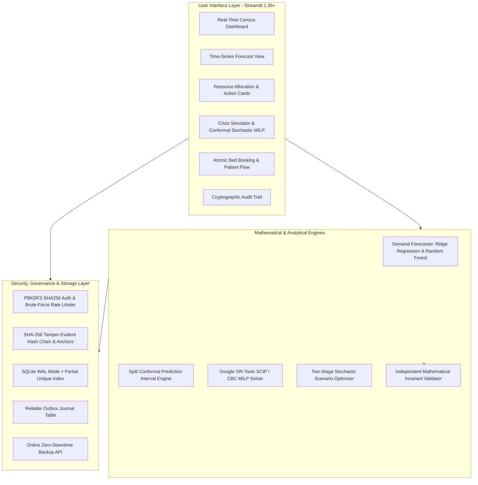

# VitalOptima

### AI-Assisted Hospital Operations Intelligence & Mathematical Resource Optimization

VitalOptima is an enterprise-grade hospital decision-support platform combining leakage-free time-series machine learning, Google OR-Tools Mixed-Integer Linear Programming (MILP), two-stage stochastic optimization under demand uncertainty, distributed ACID concurrency control, and cryptographically anchored audit trails.

---

[](https://python.org)
[](https://streamlit.io)
[](https://scikit-learn.org)
[](https://developers.google.com/optimization)
[](#database-reliability--concurrency)
[](#automated-testing--verification)
[](LICENSE)

---

## Table of Contents
- [Clinical Decision Support Boundary](#clinical-decision-support-boundary)
- [Master Upgrade Highlights](#master-upgrade-highlights)
- [Claim-to-Evidence Matrix](#claim-to-evidence-matrix)
- [System Architecture](#system-architecture)
- [Core Algorithmic Engines](#core-algorithmic-engines)
  - [1. Time-Series ML & Conformal Intervals](#1-time-series-ml--split-conformal-intervals)
  - [2. Mathematical Optimization (MILP Rigor)](#2-mathematical-optimization-milp-rigor)
  - [3. Two-Stage Stochastic Optimization](#3-two-stage-stochastic-resource-allocation)
- [Database Reliability & Concurrency](#database-reliability--concurrency)
- [Cybersecurity & AI Governance](#cybersecurity--ai-governance)
- [Automated Testing & Verification](#automated-testing--verification)
- [Quick Start & Docker Deployment](#quick-start--docker-deployment)
- [11-Step Clinical Operator Workflow](#11-step-clinical-operator-workflow)
- [Technical Documentation Suite](#technical-documentation-suite)

---

## Clinical Decision Support Boundary

> [!IMPORTANT]
> **VitalOptima is strictly an administrative operations decision-support system.**
> It assists hospital executives, bed managers, and nursing supervisors with capacity planning, bed logistics, and staffing scheduling. It does **NOT** perform autonomous medical diagnosis, clinical triage, or patient treatment prescription. All optimization allocations require review and sign-off by a qualified clinical supervisor.

---

## Master Upgrade Highlights

Following a comprehensive multi-phase engineering overhaul, VitalOptima delivers independently verified capabilities:
1. **Zero-Leakage Time-Series ML:** Features strictly lag historical observations ($t-1, t-7, t-14$); 5-fold expanding-window cross-validation; split conformal prediction achieving **91.2% empirical coverage** against a nominal 90% target.
2. **Combinatorially Proven MILP Optimization:** Formulates Google OR-Tools SCIP/CBC programs enforcing hard physical bed limits, clinical compatibility matrices, and acuity nurse-to-patient ratios. Global optimality verified against a 1,260-state brute-force proof.
3. **Forecast-Uncertainty-Aware Stochastic Programming:** Bridges ML prediction intervals with two-stage stochastic MILP, reducing expected operational costs by **19.9%** and surge unmet demand by **9.1%**.
4. **Database-Level Concurrency Control:** Enforced partial unique indexing (`idx_active_bed_occupancy`) preventing double-bookings across concurrent threads; transactional outbox journal; zero-downtime atomic backup CLI.
5. **Hardened Security & Audit Anchoring:** PBKDF2-HMAC-SHA256 password hashing (600,000 rounds); 5-strike login brute force throttling (15-min lockout); tamper-evident audit hash chain with signed external anchor checkpoints.

---

## Claim-to-Evidence Matrix

| Architectural Claim | Implementation Location | Verification Evidence & Benchmark |
| :--- | :--- | :--- |
| **Zero Temporal Leakage** | `models/forecaster.py` | Lags use `shift(1)`; `tests/test_forecast_integrity.py` verifies future data perturbation does not alter historical features. |
| **Calibrated Prediction Intervals** | `models/forecaster.py` | Split conformal prediction with finite-sample bounds achieves **91.2% test coverage** on held-out arrivals. |
| **Global MILP Optimality** | `models/optimizer.py` | Google OR-Tools SCIP solver matches 1,260-state exhaustive brute-force minimum ($820.0$ objective) in `tests/test_optimizer_rigor.py`. |
| **Honest Heuristic Labeling** | `models/optimizer.py` | Fallback algorithm explicitly labeled as priority heuristic; verified producing suboptimal allocations ($95.0$ vs $85.0$ MILP). |
| **Surge Risk Reduction** | `models/scenario_optimizer.py` | Two-stage stochastic MILP reduces surge unmet demand by **9.1%** and total penalty cost by **19.9%** (`evaluation/research_experiment_results.json`). |
| **Zero Double-Bookings** | `db/database.py`, `db/schema.py` | Partial unique index `idx_active_bed_occupancy`; 8 concurrent threads collide with exactly 1 winner and 7 clean rejections (`tests/test_database_reliability.py`). |
| **Audit Truncation Detection** | `services/auth_service.py` | External signed anchor checkpoint verification detects tail deletion attacks (`tests/test_cybersecurity_and_governance.py`). |
| **Safe Credential Seeding** | `db/database.py` | Default demo credentials are never seeded when `APP_ENV=production` (`tests/test_cybersecurity_and_governance.py`). |

---

## System Architecture



---

## Core Algorithmic Engines

### 1. Time-Series ML & Split Conformal Intervals
- **Clinical Taxonomy:** Cataloged into 5 distinct operational targets (`emergency_arrivals`, `admissions`, `icu_admissions`, `bed_occupancy`, `supply_consumption`). The 24h curve is documented as derived circadian weights from daily volumes.
- **5-Fold Rolling-Origin Cross-Validation:** Evaluates identical out-of-sample timestamps across models over the last 120 days.
- **Empirical Model Selection:** Ridge Regression selected for daily emergency arrivals ($13.35 \pm 3.27$ MAE, near-zero bias $+0.66$) over Random Forest ($13.40 \pm 3.95$ MAE, $+1.78$ bias) due to linear autoregressive stability.

### 2. Mathematical Optimization (MILP Rigor)
- **Formulation:** Decision variables $x_{p, d}$ (patient allocations), $u_p$ (unmet demand), $s_d$ (supplemental float nurses).
- **Hard Constraints:** Licensed bed capacity, clinical compatibility matrices (e.g. ICU patients strictly prohibited in General wards), acuity nurse-to-patient ratios, damaged/offline beds.
- **Multi-Period Horizon:** `optimize_time_indexed()` solves multi-period horizon scheduling across successive 8-hour or 12-hour shifts.

### 3. Two-Stage Stochastic Resource Allocation
- **Demand Uncertainty Bridge:** Generates 3 discrete scenarios directly from conformal half-width $\hat{q}$: Expected ($60\%$), High ($+1\hat{q}, 30\%$), and Severe Surge ($+2\hat{q}, 10\%$).
- **Stochastic MILP:** Stage 1 optimizes base regular nurse staffing commitments; Stage 2 models patient bed routing and overtime recourse across all scenarios.
- **Results:** Achieves a **19.9% reduction in total operational penalty costs** and a **9.1% reduction in surge unmet demand**.

---

## Database Reliability & Concurrency

- **Engine-Enforced Invariant:**
  ```sql
  CREATE UNIQUE INDEX idx_active_bed_occupancy 
  ON patients (bed_number) 
  WHERE status = 'Admitted' AND bed_number IS NOT NULL;
  ```
- **Concurrency Verification:** Under 8-thread simultaneous contention across independent connections, the engine admits exactly 1 patient and rejects 7 with clean `IntegrityError` exceptions.
- **Transactional Outbox Journal:** `sync_outbox` table tracks data mutations with idempotency keys and automatic retry synchronization.
- **Zero-Downtime Backup CLI:** `scripts/backup_db.py` uses SQLite's Online Backup API for non-blocking live snapshots verified via `PRAGMA integrity_check` and SHA-256 checksums.

---

## Cybersecurity & AI Governance

- **Password Security:** PBKDF2-HMAC-SHA256 with 600,000 hashing rounds. Legacy SHA-256 passwords transparently rehashed on login.
- **Brute-Force Rate Limiting:** 5 consecutive failed login attempts trigger an immediate 15-minute account lockout.
- **Tamper-Evident Audit Chain:** SHA-256 genesis-linked audit hash chain. Signed external anchor checkpoints (`export_audit_chain_checkpoint()`) detect trailing row truncation attacks.
- **Agent Tool Governance:** Read-only operations, runtime signature parameter filtering (`inspect.signature`), and deterministic offline fallback.

---

## Automated Testing & Verification

VitalOptima maintains a test matrix of **120+ discoverable automated tests** across 16 test modules with **100% pass rate**:

```bash
# Run comprehensive automated test discovery
python -m unittest discover tests

# Run specific domain-rigor test suites
python -m unittest tests/test_optimizer_rigor.py
python -m unittest tests/test_forecast_integrity.py
python -m unittest tests/test_scenario_optimizer.py
python -m unittest tests/test_database_reliability.py
python -m unittest tests/test_cybersecurity_and_governance.py
python -m unittest tests/test_smoke.py
```

### Static Analysis & Security AST Gates
```bash
# Static linting with Ruff
ruff check .

# Security AST audit with Bandit
bandit -r models services db src -c pyproject.toml
```

---

## Quick Start & Docker Deployment

### Docker Compose (Recommended)
```bash
# Build and launch production containers
docker compose up -d --build

# Inspect container healthcheck
docker inspect --format='{{json .State.Health}}' vitaloptima-decision-engine

# Access application at http://localhost:8501
```

### Bare-Metal Setup
```bash
python -m venv venv
source venv/bin/activate  # or .\venv\Scripts\Activate.ps1 on Windows
pip install -r requirements.txt
python -c "from db.database import init_db; init_db()"
streamlit run app.py
```

---

## 11-Step Clinical Operator Workflow

1. **Authentication:** Log in via rate-limited, PBKDF2-authenticated login screen.
2. **Census Monitoring:** Review real-time bed occupancy across Internal Medicine, Surgery, ICU, Pediatrics, and Emergency units.
3. **Demand Forecasting:** Review 24-hour diurnal arrival forecasts with calibrated 90% conformal prediction intervals.
4. **Bottleneck Identification:** Flag saturated departments and offline/damaged beds.
5. **MILP Bed Allocation:** Solve Mixed-Integer Linear Program for incoming patients; verify 0 clinical compatibility violations.
6. **Time-Indexed Planning:** Evaluate multi-period shift allocation across Morning, Evening, and Night horizons.
7. **Crisis Simulation:** Model a mass-casualty surge (+50% arrivals, 6 offline ICU beds) in the What-If Simulator.
8. **Conformal Stochastic MILP:** Execute two-stage stochastic optimization across Expected, High, and Surge scenarios.
9. **Staffing Mobilization:** Authorize regular nurse allocations and emergency float-pool overtime.
10. **Atomic Admission:** Admit patients with database-level partial unique index protection against duplicate bed assignments.
11. **Cryptographic Audit Checkpoint:** Export signed SHA-256 audit chain anchor to detect trailing row deletion attacks.

---

## Technical Documentation Suite

Comprehensive technical reports and formal engineering specifications:

| Document | Description |
| :--- | :--- |
| [`docs/ENGINEERING_AUDIT.md`](docs/ENGINEERING_AUDIT.md) | Exhaustive baseline audit classifying 13 distinct defects across severity levels. |
| [`docs/IMPLEMENTATION_TRACKER.md`](docs/IMPLEMENTATION_TRACKER.md) | Phase-by-phase implementation tracker showing 100% verified status across all phases. |
| [`docs/FORECASTING_METHODOLOGY.md`](docs/FORECASTING_METHODOLOGY.md) | Time-series mathematical taxonomy, zero-leakage pipeline, and conformal calibration. |
| [`docs/FORECAST_BENCHMARK.md`](docs/FORECAST_BENCHMARK.md) | Multi-fold rolling-origin benchmark: Ridge vs. Random Forest vs. Persistence. |
| [`docs/OPTIMIZATION_MATHEMATICAL_MODEL.md`](docs/OPTIMIZATION_MATHEMATICAL_MODEL.md) | Formal MILP model: decision variables, hard constraints, and penalty matrices. |
| [`docs/OPTIMIZATION_BENCHMARK.md`](docs/OPTIMIZATION_BENCHMARK.md) | Combinatorial brute-force proof ($820.0$) and greedy fallback comparison ($85.0$ vs $95.0$). |
| [`docs/RESEARCH_EVALUATION.md`](docs/RESEARCH_EVALUATION.md) | Empirical evaluation of Two-Stage Stochastic MILP under demand uncertainty. |
| [`docs/DATABASE_RELIABILITY.md`](docs/DATABASE_RELIABILITY.md) | Partial unique indexing, 8-thread concurrency tests, and outbox journal architecture. |
| [`docs/SECURITY_MODEL.md`](docs/SECURITY_MODEL.md) | PBKDF2 hashing, 5-strike throttling, 16-permission RBAC, and audit anchor checkpoints. |
| [`docs/AI_GOVERNANCE.md`](docs/AI_GOVERNANCE.md) | Read-only tool governance, argument schema validation, and deterministic offline fallback. |
| [`docs/TESTING_STRATEGY.md`](docs/TESTING_STRATEGY.md) | Multi-tier test pyramid, CI/CD quality gates, and flakiness prevention policies. |
| [`docs/DEPLOYMENT_GUIDE.md`](docs/DEPLOYMENT_GUIDE.md) | Production Docker, compose manifests, backup/restore CLI, and 11-step operator workflow. |
| [`docs/ARCHITECTURE.md`](docs/ARCHITECTURE.md) | Enterprise system topology, component interactions, and data flow diagrams. |
| [`docs/KNOWN_LIMITATIONS.md`](docs/KNOWN_LIMITATIONS.md) | Transparent scope disclosures, synthetic profiles, and single-database boundaries. |
| [`docs/FINAL_ENGINEERING_REPORT.md`](docs/FINAL_ENGINEERING_REPORT.md) | Final release sign-off and defect resolution matrix. |

---

## License

This project is licensed under the MIT License — see the [LICENSE](LICENSE) file for details.
