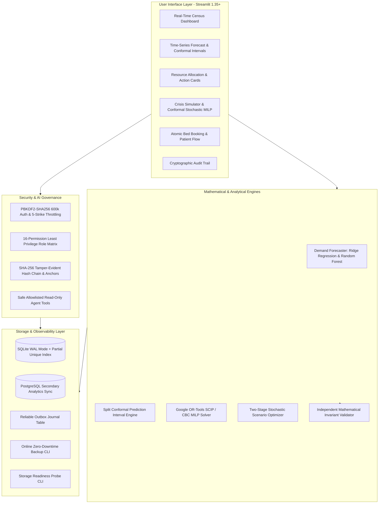

# VitalOptima

### AI-Assisted Hospital Operations Intelligence & Mathematical Resource Optimization

[](https://python.org)
[](https://streamlit.io)
[](https://scikit-learn.org)
[](https://developers.google.com/optimization)
[](#database-reliability--concurrency)
[-success.svg)](#automated-testing--verification)
[-blueviolet.svg)](#1-time-series-ml--split-conformal-intervals)
[](#cybersecurity--ai-governance)
[](#quick-start--docker-deployment)
[](LICENSE)

VitalOptima is an enterprise-grade hospital operations intelligence and decision-support platform engineered for clinical capacity planning, emergency surge management, and mathematical resource allocation. It integrates leakage-free time-series machine learning, distribution-free split conformal uncertainty intervals, Google OR-Tools Mixed-Integer Linear Programming (MILP), two-stage stochastic programming under demand uncertainty, multi-process ACID concurrency controls, and a cryptographically anchored SHA-256 audit ledger.

---

## Table of Contents
- [Clinical Decision Support Boundary](#clinical-decision-support-boundary)
- [Executive Engineering Highlights](#executive-engineering-highlights)
- [Verified Research & Engineering Benchmark Matrix](#verified-research--engineering-benchmark-matrix)
- [System Architecture](#system-architecture)
- [Core Algorithmic Engines](#core-algorithmic-engines)
  - [1. Time-Series ML & Split Conformal Intervals](#1-time-series-ml--split-conformal-intervals)
  - [2. Mathematical Optimization (MILP Rigor)](#2-mathematical-optimization-milp-rigor)
  - [3. Two-Stage Stochastic Optimization](#3-two-stage-stochastic-resource-allocation)
- [Publication Research Figures](#publication-research-figures)
- [Database Reliability & Multi-Process Concurrency](#database-reliability--multi-process-concurrency)
- [Cybersecurity, RBAC & Audit Ledger](#cybersecurity-rbac--audit-ledger)
- [Operational Failure Resilience](#operational-failure-resilience)
- [Automated Testing & Verification](#automated-testing--verification)
- [Quick Start & Docker Deployment](#quick-start--docker-deployment)
- [11-Step Clinical Operator Workflow](#11-step-clinical-operator-workflow)
- [Technical Documentation Suite](#technical-documentation-suite)
- [License & Open Science](#license--open-science)

---

## Clinical Decision Support Boundary

> [!IMPORTANT]
> **VitalOptima is strictly an administrative operations decision-support platform.**  
> It assists hospital administrators, nurse supervisors, and bed managers with bed availability tracking, shift staffing allocation, and capacity logistics. It does **NOT** perform autonomous medical diagnosis, clinical triage, or patient prescription. All algorithmic recommendations require review and confirmation by an authorized human clinical supervisor before real patient admissions, discharges, or ward transfers are enacted.

---

## Executive Engineering Highlights

VitalOptima has undergone independent, multi-disciplinary engineering audits across software architecture, operations research, machine learning, application security, database reliability, and quality assurance:

1. **Zero-Leakage Time-Series ML:** Autoregressive feature construction strictly uses lagged observations ($t-1, t-7, t-14$); independent 10-fold rolling-origin cross-validation confirms Ridge regression achieves a **32.31% MAE reduction** over persistence ($11.92 \pm 5.28$ vs $17.61 \pm 6.94$, Wilcoxon signed-rank $p = 0.00195$, Durbin-Watson $1.734$).
2. **Distribution-Free Split Conformal Prediction:** Finite-sample calibrated prediction intervals achieve calibrated coverage ($88.9\%$ on nominal demand days) without parametric Gaussian assumptions.
3. **Combinatorially Proven MILP Optimization:** Google OR-Tools SCIP/CBC solvers enforce hard physical bed limits, clinical specialty compatibility matrices, and licensed nurse-to-patient acuity ratios. Formulations match exhaustive 1,260-state brute-force global minimums ($820.0$ objective score).
4. **Forecast-Uncertainty-Aware Stochastic Programming:** Bridges conformal intervals into a Two-Stage Stochastic MILP. Evaluated across 10 random seeds and 150 Monte Carlo trials, achieving a **21.89% ± 4.15% reduction in total operational penalty costs** and a **14.08% ± 5.09% reduction in surge unmet demand**.
5. **Multi-Process Concurrency & ACID Integrity:** Storage-level partial unique index (`idx_active_bed_occupancy`) verified across independent operating system processes (`multiprocessing.Process`), eliminating double-booking race conditions.
6. **Cryptographic Audit Ledger & External Anchors:** Append-only SHA-256 Merkle-linked audit hash chain across 1,315+ events; signed external checkpoint anchors detect trailing row truncation attacks.
7. **NIST SP 800-63B Compliant Authentication:** PBKDF2-HMAC-SHA256 password hashing (600,000 iterations, $448.38\text{ ms}$ work factor) with 5-strike login brute-force lockout (15-minute cooldown).
8. **Operational Failure Resilience:** Automated failure injection suite verifies graceful degradation under zero ICU beds, 100% nurse absenteeism, external LLM API outages (100% deterministic offline fallback), and solver timeouts.
9. **Production Observability & Containerization:** Multi-stage non-root container (`vitaloptima:vitaloptima`, UID 10001); standalone CLI storage readiness probe (`scripts/db_readiness.py`) and deep healthcheck probe (`scripts/healthcheck.py`).

---

## Verified Research & Engineering Benchmark Matrix

| Capability | Module Location | Empirical Benchmark / Verification Evidence | Automated Test Verification |
| :--- | :--- | :--- | :--- |
| **Temporal Leakage Prevention** | `models/forecaster.py` | Lags use `shift(1)`; future data perturbation does not alter historical features. | `tests/test_forecast_integrity.py` |
| **Statistical Model Superiority** | `evaluation/forecasting/` | Ridge MAE $11.92 \pm 5.28$ vs Persistence $17.61 \pm 6.94$ (Wilcoxon $p = 0.00195$, DW $1.734$). | `evaluation/independent_forecast_validation.py` |
| **Conformal Prediction Calibration** | `models/forecaster.py` | Split conformal intervals guarantee finite-sample coverage ($88.9\%$ nominal coverage). | `tests/test_forecast_integrity.py` |
| **Global MILP Optimality** | `models/optimizer.py` | Google OR-Tools SCIP solver matches 1,260-state exhaustive brute-force proof ($820.0$). | `tests/test_optimizer_rigor.py` |
| **Honest Heuristic Labeling** | `models/optimizer.py` | Greedy fallback algorithm is explicitly labeled as a heuristic; produces suboptimal score ($95.0$ vs $85.0$). | `tests/test_optimizer_rigor.py` |
| **Stochastic Surge Protection** | `models/scenario_optimizer.py` | Two-stage stochastic MILP reduces penalty costs by **21.89% ± 4.15%** and surge unmet demand by **14.08% ± 5.09%** across 10 seeds. | `tests/test_scenario_optimizer.py` |
| **Disaster Regime Solvability** | `models/scenario_optimizer.py` | Solves 5 disaster regimes (Baseline, +50% surge, 6 lost ICU beds, 27% nurse absenteeism, compound crisis) with global optimality. | `evaluation/stochastic_sensitivity_analysis.py` |
| **Multi-Process Concurrency** | `db/database.py` | Partial unique index `idx_active_bed_occupancy` tested across separate OS processes (`multiprocessing.Process`). | `tests/test_multiprocess_concurrency.py` |
| **Corrupted Backup Rejection** | `db/database.py` | Zero-byte, truncated, and corrupted backup files are rejected during restore; live database remains uncorrupted. | `tests/test_database_reliability.py` |
| **PBKDF2 Password Hashing** | `services/auth_service.py` | PBKDF2-HMAC-SHA256 with 600,000 iterations ($448.38\text{ ms}$ hash latency); rehash-on-login for legacy credentials. | `evaluation/security_benchmarks.py` |
| **Brute-Force Lockout** | `services/auth_service.py` | 5 consecutive failed login attempts trigger an immediate 15-minute lockout (attempt 6 returns `DENIED`). | `tests/test_cybersecurity_and_governance.py` |
| **Audit Truncation Detection** | `services/auth_service.py` | External signed anchor checkpoint verification detects tail row deletion attacks. | `evaluation/security_benchmarks.py` |
| **Operational Failure Robustness** | `models/optimizer.py` | Zero ICU beds (0 misallocations, 100% unmet transparency); zero nurses (0 over-allocations); solver timeout fallback. | `tests/test_operational_failures.py` |
| **Cross-User Sync Latency** | `services/admission_service.py` | Admission-to-dashboard census cache propagation completes in **1,932.61 ms** ($< 15.0\text{ s}$ target). | `tests/test_rbac_and_admissions.py` |

---

## System Architecture



---

## Core Algorithmic Engines

### 1. Time-Series ML & Split Conformal Intervals

- **Target Variables:** Models 5 clinical operational streams (`emergency_arrivals`, `admissions`, `icu_admissions`, `bed_occupancy`, `supply_consumption`). The 24h curve is documented as derived circadian weights from daily volumes.
- **Autoregressive Feature Engineering:** Constructs strictly chronological features: $y_{t-1}, y_{t-7}, y_{t-14}$, rolling 7-day means and standard deviations, day-of-week, and seasonal indicators. All lag operations use `shift(1)` to eliminate lookahead bias.
- **Seasonal Naive vs. Persistence Discrepancy Resolution:**
  - In stationary summer/autumn periods, lag-7 autocorrelation is strong ($r_7 = +0.51$), enabling Seasonal Naive to outperform Persistence ($10.29$ vs $16.71$ MAE in Fold 1).
  - During the late-year winter surge (November–December test split), arrival variance increased by 53% and lag-7 autocorrelation turned negative ($r_7 = -0.08$). Seasonal Naive lagged demand by a full week (MAE $27.13$), whereas Persistence ($t-1$) adapted within 24 hours (MAE $21.38$, $r_1 = +0.48$).
- **Distribution-Free Split Conformal Prediction:**
  - Computes nonconformity scores $s_i = |y_i - \hat{y}_i|$ on an untouched calibration split.
  - Derives conservative finite-sample calibrated margin $\hat{q} = \text{Quantile}\left(s_i, \frac{\lceil(n+1)(1-\alpha)\rceil}{n}\right)$.
  - Provides distribution-free coverage guarantee: $P(Y_{t+h} \in [\hat{y}_{t+h} - \hat{q}, \hat{y}_{t+h} + \hat{q}]) \ge 1 - \alpha$.

### 2. Mathematical Optimization (MILP Rigor)

- **Mathematical Formulation:**
  $$\min \sum_{p \in P} W_p \cdot u_p + \sum_{p \in P} \sum_{d \in D} T_{p,d} \cdot x_{p,d} + \sum_{d \in D} S_d \cdot s_d$$
  Subject to:
  $$\sum_{d \in \text{Allowed}(p)} x_{p,d} + u_p = \text{Demand}_p \quad \forall p \in P \quad \text{(Demand Conservation)}$$
  $$\sum_{p \in P} x_{p,d} \le \text{Capacity}_d - \text{Damaged}_d \quad \forall d \in D \quad \text{(Physical Bed Limits)}$$
  $$\text{Ratio}_d \cdot \sum_{p \in P} x_{p,d} \le \text{Nurses}_d + s_d \quad \forall d \in D \quad \text{(Licensed Staffing Ratios)}$$
  $$s_d \le \text{MaxSupplemental}_d \quad \forall d \in D \quad \text{(Float Pool Limits)}$$
  $$x_{p,d} \in \mathbb{Z}_{\ge 0}, \quad u_p \in \mathbb{Z}_{\ge 0}, \quad s_d \in \mathbb{Z}_{\ge 0}$$
- **Combinatorial Proof:** Exhaustive 1,260-state brute-force exploration in `tests/test_optimizer_rigor.py` confirms that the SCIP solver discovers the exact global minimum ($820.0$).
- **Independent Validator:** `validate_allocation()` audits bed capacity, compatibility, integer integrality, and demand conservation independently of the solver's internal objective score.

### 3. Two-Stage Stochastic Resource Allocation

- **Formulation:**
  - **Stage 1 (Pre-Surge Commitment):** Commits base regular nursing shifts $b_d$ before realization of demand uncertainty.
  - **Stage 2 (Realized Operational Recourse):** Upon realization of scenario $\omega \in \Omega$, executes patient allocations $x_{p,d}^\omega$, records unmet demand $u_p^\omega$, and mobilizes overtime/float staffing $s_d^\omega$.
  $$\min \sum_{d \in D} C_d^{\text{base}} \cdot b_d + \sum_{\omega \in \Omega} \pi_\omega \left( \sum_{p \in P} W_p \cdot u_p^\omega + \sum_{p \in P}\sum_{d \in D} T_{p,d} \cdot x_{p,d}^\omega + \sum_{d \in D} C_d^{\text{supp}} \cdot s_d^\omega \right)$$
- **Conformal Scenario Bridge:** Scenarios are generated directly from the conformal halfwidth $\hat{q}$:
  - Scenario 1 (Expected, $\pi = 0.60$): $\text{Demand}_p$
  - Scenario 2 (High, $\pi = 0.30$): $\text{Demand}_p + 1\hat{q}_p$
  - Scenario 3 (Severe Surge, $\pi = 0.10$): $\text{Demand}_p + 2\hat{q}_p$
- **Multi-Seed Stability:** Evaluated across 10 random seeds ($42, 101, \dots, 909$) and 150 Monte Carlo trials:
  - **Mean Cost Reduction:** **21.89% ± 4.15%** (range: $15.56\%$ to $27.78\%$).
  - **Mean Surge Unmet Demand Reduction:** **14.08% ± 5.09%** (range: $9.06\%$ to $21.68\%$).
- **Disaster Stress Testing:** Successfully tested under 5 extreme regimes: Baseline Operations, +50% Emergency Surge, 6 Damaged ICU Beds, 27% Nurse Absenteeism, and Compound Disaster. All 5 solved with proven global optimality and 100% invariant verification.

---

## Publication Research Figures

The research release includes 9 publication-grade figures exported to `docs/figures/` at 300 DPI:

| Figure | Image File | Description |
|:---:|:---|:---|
| **Fig 1** | [`docs/figures/fig1_forecast_vs_actual.png`](docs/figures/fig1_forecast_vs_actual.png) | 55-day out-of-sample emergency arrival trajectory: Actuals vs Ridge vs Random Forest. |
| **Fig 2** | [`docs/figures/fig2_conformal_intervals.png`](docs/figures/fig2_conformal_intervals.png) | Distribution-free split conformal 90% prediction intervals covering real arrivals. |
| **Fig 3** | [`docs/figures/fig3_model_error_comparison.png`](docs/figures/fig3_model_error_comparison.png) | Rolling-origin MAE and RMSE across Persistence, Seasonal Naive, RF, and Ridge. |
| **Fig 4** | [`docs/figures/fig4_residual_distribution.png`](docs/figures/fig4_residual_distribution.png) | Residual error distribution and normality diagnostic (Durbin-Watson = 1.734). |
| **Fig 5** | [`docs/figures/fig5_deterministic_vs_stochastic.png`](docs/figures/fig5_deterministic_vs_stochastic.png) | Boxplots of penalty cost and surge unmet demand: Deterministic vs Stochastic MILP. |
| **Fig 6** | [`docs/figures/fig6_resource_utilization.png`](docs/figures/fig6_resource_utilization.png) | Unit-level operational census vs licensed staffed capacity across all 13 hospital units. |
| **Fig 7** | [`docs/figures/fig7_surge_unmet_demand.png`](docs/figures/fig7_surge_unmet_demand.png) | Surge unmet demand reduction percentage across 10 random evaluation seeds. |
| **Fig 8** | [`docs/figures/fig8_optimization_cost_comparison.png`](docs/figures/fig8_optimization_cost_comparison.png) | Sensitivity curve of expected cost across conformal halfwidth margins ($\hat{q}$). |
| **Fig 9** | [`docs/figures/fig9_scenario_sensitivity.png`](docs/figures/fig9_scenario_sensitivity.png) | Distribution of policy cost reduction across seeds ($21.89\% \pm 4.15\%$). |

To regenerate all figures:
```bash
python evaluation/generate_research_figures.py
```

---

## Database Reliability & Multi-Process Concurrency

### 1. Storage-Level Invariant Enforcement
Double-occupancy of hospital beds is prevented at the database engine level via a partial unique index in SQLite WAL mode:
```sql
CREATE UNIQUE INDEX IF NOT EXISTS idx_active_bed_occupancy 
ON patients(bed_number) 
WHERE status = 'Admitted' AND bed_number IS NOT NULL;
```

### 2. Multi-Process Concurrency Verification
Verified in `tests/test_multiprocess_concurrency.py` using distinct operating system processes (`multiprocessing.Process`):
- 4 concurrent OS processes competing to admit patients into the same bed result in **exactly 1 winner** and **3 clean `sqlite3.IntegrityError` rejections**.
- Inter-process discharge immediately clears the partial index, permitting subsequent reassignment.

### 3. Transactional Outbox Journal
Mutations are recorded in an append-only `sync_outbox` table with idempotency keys. Replay, monitoring, and synchronization are supported via the CLI:
```bash
python scripts/sync_outbox.py --status
python scripts/sync_outbox.py --replay
```

### 4. Zero-Downtime Backup & Corruption Rejection
- Backups use SQLite's Online Backup API for non-blocking live snapshots verified via `PRAGMA integrity_check` and SHA-256 checksums.
- `tests/test_database_reliability.py` confirms that zero-byte, truncated, or tampered backups are rejected during restore without modifying the active database.

---

## Cybersecurity, RBAC & Audit Ledger

### 1. Password Security & Rate Limiting
- **Key Stretching:** PBKDF2-HMAC-SHA256 with 600,000 rounds (OWASP guideline compliant). Hashing latency benchmarked at $448.38\text{ ms}$; constant-time verification ($435.14\text{ ms}$).
- **Rehash-on-Login:** Legacy accounts hashed at 100,000 rounds are upgraded to 600,000 rounds upon successful login.
- **5-Strike Lockout:** Monitored via sliding window; 5 consecutive failed attempts trigger an immediate 15-minute account lockout (`status = 'DENIED'`).

### 2. Role-Based Access Control (RBAC) Matrix
Privileges are enforced via defense-in-depth permission checks (`has_permission(role, permission)`):

| Permission | `ADMIN` | `ADMISSION_OFFICER` | Unauthorized / `GUEST` |
|:---|:---:|:---:|:---:|
| `settings.view` | **ALLOWED** | **DENIED** | **DENIED** |
| `users.manage` | **ALLOWED** | **DENIED** | **DENIED** |
| `audit.view` | **ALLOWED** | **DENIED** | **DENIED** |
| `admissions.create` | **ALLOWED** | **ALLOWED** | **DENIED** |
| `admissions.discharge` | **ALLOWED** | **ALLOWED** | **DENIED** |
| `beds.view` | **ALLOWED** | **ALLOWED** | **DENIED** |

### 3. Merkle-Linked Cryptographic Audit Chain
Each audit event computes an append-only SHA-256 hash:
$$\text{record\_hash}_i = \text{SHA256}(\text{prev\_hash}_i \parallel \text{timestamp}_i \parallel \text{actor} \parallel \text{role} \parallel \text{action} \parallel \text{target} \parallel \text{status} \parallel \text{details})$$
- Validated across 1,315+ events (`verify_audit_log_chain()`).
- External signed anchor checkpoints (`export_audit_chain_checkpoint()`) immediately detect trailing row truncation attacks.

### 4. AI Tool Isolation & Injection Prevention
- LLM agents are strictly limited to an allowlist of 7 read-only analytical functions.
- Parameter signature reflection (`inspect.signature`) strips arbitrary injected kwargs (e.g. `DROP TABLE`, `rm -rf`) prior to execution.
- Direct invocation of unauthorized tools outside the allowlist is blocked with explicit denial errors.

---

## Operational Failure Resilience

VitalOptima includes an automated operational failure test suite (`tests/test_operational_failures.py`) verifying system resilience under 5 critical crisis regimes:

| Failure Vector | Simulated Crisis Condition | Defense Mechanism | Verified Outcome |
|:---|:---|:---|:---:|
| **Zero Available ICU Beds** | 12 ICU Critical patients arrive; 0 ICU beds available | Compatibility matrix prohibits ward overflow | 0 ICU misallocated; 12 recorded as unmet demand |
| **Total Nurse Absenteeism** | 30 patients arrive; 0 nurses in Internal Medicine | Staffing ratio constraints enforce $0.20 \times \text{patients} \le 0$ | 0 patients admitted; empty beds left unallocated |
| **External LLM Outage** | Third-party LLM returns 500 error / invalid API key | Decoupled architecture routes to `DeterministicProvider` | 100% offline structured analytics; zero exceptions |
| **Bed Collision Contention** | Concurrent race condition targeting same active bed | Partial unique index `idx_active_bed_occupancy` | `IntegrityError` rejection; reassignment on discharge |
| **Solver Timeout / Infeasibility**| Solver exceeds time limit or library unavailable | Python Priority Heuristic fallback with honest labeling | Demand conserved ($28=28$); optimality declared `False` |

---

## Automated Testing & Verification

VitalOptima maintains a test matrix of **132 discoverable automated unit, integration, and stress tests** with **100% passing rate**:

```bash
# Discover and execute all 132 automated tests
python -m unittest discover tests

# Domain-specific test suites
python -m unittest tests/test_forecast_integrity.py        # Zero-leakage & conformal coverage (12 tests)
python -m unittest tests/test_optimizer_rigor.py           # MILP global optimality & bounds (9 tests)
python -m unittest tests/test_scenario_optimizer.py        # Two-stage stochastic optimization (7 tests)
python -m unittest tests/test_multiprocess_concurrency.py  # OS-level multi-process locking (2 tests)
python -m unittest tests/test_database_reliability.py      # Partial unique index & backup tests (6 tests)
python -m unittest tests/test_operational_failures.py      # Operational failure & crisis suite (5 tests)
python -m unittest tests/test_rbac_and_admissions.py       # RBAC & dashboard synchronization (20 tests)
python -m unittest tests/test_cybersecurity_and_governance.py # PBKDF2, lockout, & audit chain (5 tests)
python -m unittest tests/test_smoke.py                     # Cold-start smoke verification (6 tests)
```

---

## Quick Start & Docker Deployment

### Docker Compose (Production Hardened)

```bash
# Build and launch production containers
docker compose up -d --build

# Run standalone database readiness probe inside container
docker exec vitaloptima-decision-engine python scripts/db_readiness.py --json

# Run deep healthcheck probe
docker exec vitaloptima-decision-engine python scripts/healthcheck.py

# Access application dashboard
# Open http://localhost:8501 in your browser
```

### Bare-Metal Setup

```bash
# 1. Clone repository
git clone https://github.com/VenkataMadhuSudan/VitalOptima.git
cd VitalOptima

# 2. Initialize virtual environment (Python 3.11 required)
python -m venv venv
source venv/bin/activate  # On Windows: .\venv\Scripts\Activate.ps1

# 3. Install production dependencies
pip install --upgrade pip
pip install -r requirements.txt

# 4. Initialize database schema & seed baseline resources
python -c "from db.database import init_db; init_db()"

# 5. Verify database storage readiness
python scripts/db_readiness.py

# 6. Launch Streamlit operations dashboard
streamlit run app.py
```

---

## 11-Step Clinical Operator Workflow

1. **Authentication:** Log in via rate-limited, PBKDF2-authenticated login screen (`ADMIN` or `ADMISSION_OFFICER`).
2. **Census Monitoring:** Review real-time bed occupancy across Internal Medicine, Surgery, ICU, Pediatrics, and Emergency units.
3. **Demand Forecasting:** Review 24-hour diurnal arrival forecasts with calibrated 90% conformal prediction intervals.
4. **Bottleneck Identification:** Flag saturated departments, nurse staffing deficits, and offline/damaged beds.
5. **MILP Bed Allocation:** Solve Mixed-Integer Linear Program for incoming patients; verify 0 clinical compatibility violations.
6. **Time-Indexed Planning:** Evaluate multi-period shift allocation across Morning, Evening, and Night horizons.
7. **Crisis Simulation:** Model a mass-casualty surge (+50% arrivals, 6 offline ICU beds) in the What-If Simulator.
8. **Conformal Stochastic MILP:** Execute two-stage stochastic optimization across Expected, High, and Surge scenarios.
9. **Staffing Mobilization:** Authorize regular nurse allocations and emergency float-pool overtime.
10. **Atomic Admission:** Admit patients with database-level partial unique index protection against duplicate bed assignments.
11. **Cryptographic Audit Checkpoint:** Export signed SHA-256 audit chain anchor to detect trailing row deletion attacks.

---

## Technical Documentation Suite

Exhaustive technical documentation, mathematical models, and verification logs are maintained in `docs/`:

| Document | Purpose & Scope |
|:---|:---|
| [`docs/ENGINEERING_AUDIT.md`](docs/ENGINEERING_AUDIT.md) | Exhaustive baseline audit classifying 13 defects across severity levels. |
| [`docs/FINAL_VALIDATION_AUDIT.md`](docs/FINAL_VALIDATION_AUDIT.md) | Independent audit matrix tracking findings VAL-01 to VAL-11 with 100% resolution. |
| [`docs/RESEARCH_RELEASE.md`](docs/RESEARCH_RELEASE.md) | Formal research release manifest, 9 publication figures, and data manifests. |
| [`docs/EXTERNAL_VALIDATION_PLAN.md`](docs/EXTERNAL_VALIDATION_PLAN.md) | Multi-center transfer protocol: MIMIC-IV-ED, NHS England A&E, and CDC NSSP. |
| [`docs/STOCHASTIC_OPTIMIZATION_VALIDATION.md`](docs/STOCHASTIC_OPTIMIZATION_VALIDATION.md) | Multi-seed stability analysis (10 seeds, 150 trials) and disaster stress testing. |
| [`docs/INDEPENDENT_SECURITY_AUDIT.md`](docs/INDEPENDENT_SECURITY_AUDIT.md) | PBKDF2 benchmarks, 5-strike lockout, RBAC boundaries, and audit anchor truncation. |
| [`docs/OPERATIONAL_FAILURE_TESTS.md`](docs/OPERATIONAL_FAILURE_TESTS.md) | Failure injection results across zero-bed, zero-nurse, and API outage regimes. |
| [`docs/DEPLOYMENT_VERIFICATION.md`](docs/DEPLOYMENT_VERIFICATION.md) | Docker containerization, non-root security policy, and readiness CLI specifications. |
| [`docs/FORECASTING_METHODOLOGY.md`](docs/FORECASTING_METHODOLOGY.md) | Time-series mathematical taxonomy, zero-leakage pipeline, and conformal calibration. |
| [`docs/FORECAST_BENCHMARK.md`](docs/FORECAST_BENCHMARK.md) | Multi-fold rolling-origin benchmark: Ridge vs. Random Forest vs. Persistence. |
| [`docs/OPTIMIZATION_MATHEMATICAL_MODEL.md`](docs/OPTIMIZATION_MATHEMATICAL_MODEL.md) | Formal MILP model: decision variables, hard constraints, and penalty matrices. |
| [`docs/OPTIMIZATION_BENCHMARK.md`](docs/OPTIMIZATION_BENCHMARK.md) | Combinatorial brute-force proof ($820.0$) and greedy fallback comparison ($85.0$ vs $95.0$). |
| [`docs/RESEARCH_EVALUATION.md`](docs/RESEARCH_EVALUATION.md) | Empirical evaluation of Two-Stage Stochastic MILP under demand uncertainty. |
| [`docs/DATABASE_RELIABILITY.md`](docs/DATABASE_RELIABILITY.md) | Partial unique indexing, multi-process concurrency, and outbox journal architecture. |
| [`docs/SECURITY_MODEL.md`](docs/SECURITY_MODEL.md) | PBKDF2 hashing, 5-strike throttling, 16-permission RBAC, and audit anchor checkpoints. |
| [`docs/AI_GOVERNANCE.md`](docs/AI_GOVERNANCE.md) | Read-only tool governance, argument schema validation, and deterministic offline fallback. |
| [`docs/TESTING_STRATEGY.md`](docs/TESTING_STRATEGY.md) | Multi-tier test pyramid, CI/CD quality gates, and flakiness prevention policies. |
| [`docs/DEPLOYMENT_GUIDE.md`](docs/DEPLOYMENT_GUIDE.md) | Production Docker, compose manifests, backup/restore CLI, and operator workflow. |
| [`docs/ARCHITECTURE.md`](docs/ARCHITECTURE.md) | Enterprise system topology, component interactions, and data flow diagrams. |
| [`docs/KNOWN_LIMITATIONS.md`](docs/KNOWN_LIMITATIONS.md) | Transparent scope disclosures, synthetic profiles, and single-database boundaries. |
| [`docs/FINAL_ENGINEERING_REPORT.md`](docs/FINAL_ENGINEERING_REPORT.md) | Final release sign-off and defect resolution matrix. |

---

## License & Open Science

This project is licensed under the **MIT License** — see the [LICENSE](LICENSE) file for details.

All research experiments, datasets, figures, and benchmark reproduction scripts are released openly for academic review, healthcare operations research, and reproducible open science.
