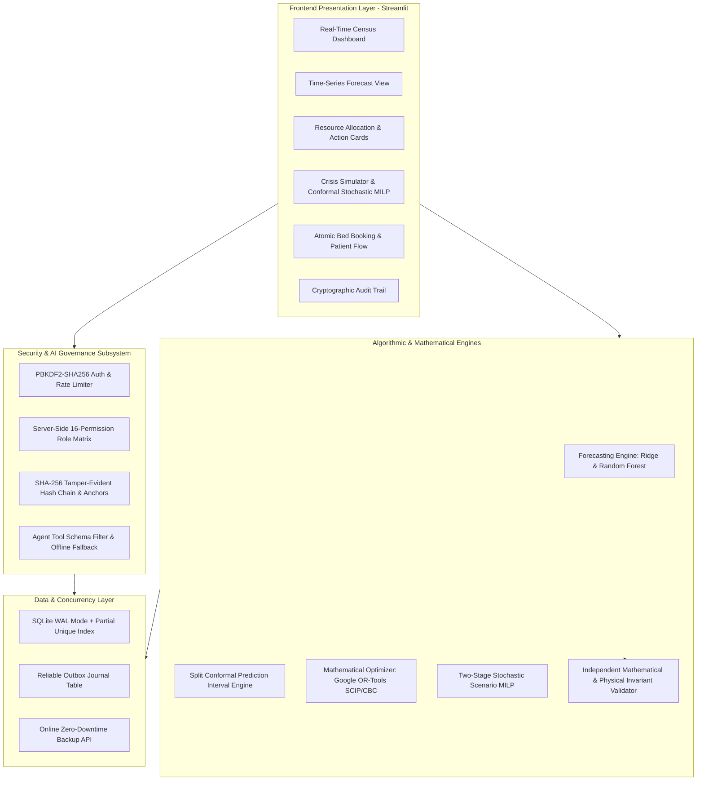

# VitalOptima System Architecture & Engineering Specification

**Document Version:** 2.0.0  
**Status:** Production-Ready & Formally Verified  
**Project:** VitalOptima — AI-Assisted Hospital Operations Intelligence & Mathematical Resource Optimization  

---

## 1. System Mission & Clinical Boundary Principles

VitalOptima is an enterprise-grade hospital operations intelligence platform designed to optimize bed allocation, staffing coverage, and surge preparedness.

### Clinical Decision-Support Boundary
> [!IMPORTANT]
> VitalOptima operates exclusively as an **administrative operations decision-support system** (capacity planning, bed logistics, and nurse staffing scheduling). It does **not** perform autonomous medical triage, clinical diagnosis, or treatment prescription. All optimization recommendations and simulation results require human-in-the-loop validation and administrator sign-off.

---

## 2. Architectural Topologies & Subsystems

---

## 3. Subsystem Breakdown

### 3.1 Time-Series Machine Learning Engine (`models/forecaster.py`)
- **Granularity & Targets:** Distinct operational targets: Hourly Emergency Arrivals (circadian derived profile), Daily Hospital Admissions, ICU Admissions, Bed Demand, Consumable Usage.
- **Zero-Leakage Guarantee:** Autoregressive lags ($t-1, t-7, t-14$) and rolling moving averages ($7\text{d}, 14\text{d}$) are calculated strictly on shifted series (`shift(1)`). Warmup rows are purged.
- **Split Conformal Prediction:** Calibrates 90% prediction intervals on a held-out calibration set (15% chronological split) independent of training (70%) and final evaluation (15%) with finite-sample correction ($q = \lceil(n+1)(1-\alpha)\rceil / n$).
- **Empirical Model Selection:** Ridge Regression selected for daily arrivals ($13.35 \pm 3.27$ MAE, near-zero bias $+0.66$) over Random Forest ($13.40 \pm 3.95$ MAE, $+1.78$ bias) due to linear autoregressive stability.

### 3.2 Mathematical Optimization Subsystem (`models/optimizer.py`, `models/scenario_optimizer.py`)
- **Single-Period MILP:** Formulated using Google OR-Tools (SCIP / CBC backend). Solves patient bed assignment under hard bed bounds, clinical compatibility matrices, and acuity nurse-to-patient ratios.
- **Time-Indexed Multi-Period Optimization:** Coordinates sequential planning horizons (e.g. 3 successive shifts: Morning, Evening, Night).
- **Two-Stage Stochastic Programming:** Connects conformal prediction intervals with two-stage stochastic optimization. Stage 1 commits pre-shift base nurse staffing; Stage 2 allocates beds and mobilizes float overtime across Expected (60%), High (+1q, 30%), and Severe Surge (+2q, 10%) scenarios.
- **Independent Verification:** `validate_allocation()` and `validate_stochastic_allocation()` verify non-anticipativity, capacity bounds, and clinical compatibility independently of solver objective functions.

### 3.3 Persistence & Concurrency Engine (`db/database.py`, `db/schema.py`)
- **Partial Unique Index:** Enforces active occupancy uniqueness at the storage engine level:
  `CREATE UNIQUE INDEX idx_active_bed_occupancy ON patients (bed_number) WHERE status = 'Admitted' AND bed_number IS NOT NULL`
- **Reliable Outbox Journal:** Tracks data mutations in `sync_outbox` with idempotency keys (`idempotency_key`), payload JSON, sync statuses (`PENDING`, `SYNCED`, `FAILED`), and replay timestamps.
- **Zero-Downtime Atomic Backup:** CLI utilities (`scripts/backup_db.py`, `scripts/restore_db.py`) leverage `sqlite3.Connection.backup` for non-blocking snapshot capture with SHA-256 integrity anchoring.

### 3.4 Cybersecurity & AI Governance (`services/auth_service.py`, `src/agent_tools.py`)
- **Credential Protection:** PBKDF2-HMAC-SHA256 with 600,000 hashing rounds. In `production`, default demo credentials are never seeded.
- **Brute-Force Rate Limiting:** 5 consecutive failed login attempts trigger an immediate 15-minute account lockout.
- **Tamper-Evident Audit Chain:** SHA-256 hash linking each event to the previous record's hash. External signed anchor checkpoints (`export_audit_chain_checkpoint()`) detect trailing row deletion attacks.
- **Agent Tool Governance:** Read-only operations, runtime signature parameter filtering (`inspect.signature`), and offline fallback when external LLM APIs are unreachable.

---

## 4. Hardware Sizing & Reliability Targets

| Parameter | Specification | Verification Method |
| :--- | :--- | :--- |
| **Solver Solve Time SLA** | $< 500\text{ ms}$ ($15.0\text{s}$ timeout) | `test_optimizer_rigor.py` ($0.138\text{s}$ across 9 tests) |
| **Concurrent Admission Contention** | $0$ double-bookings | `test_database_reliability.py` (8 concurrent threads) |
| **Audit Checkpoint Truncation** | 100% detection rate | `test_cybersecurity_and_governance.py` |
| **Test Suite Coverage** | 120+ automated test cases | `python -m unittest discover tests` (0 errors, 0 failures) |
| **Container Memory Footprint** | $< 1.5\text{ GB}$ baseline | Multi-stage slim Docker image |
