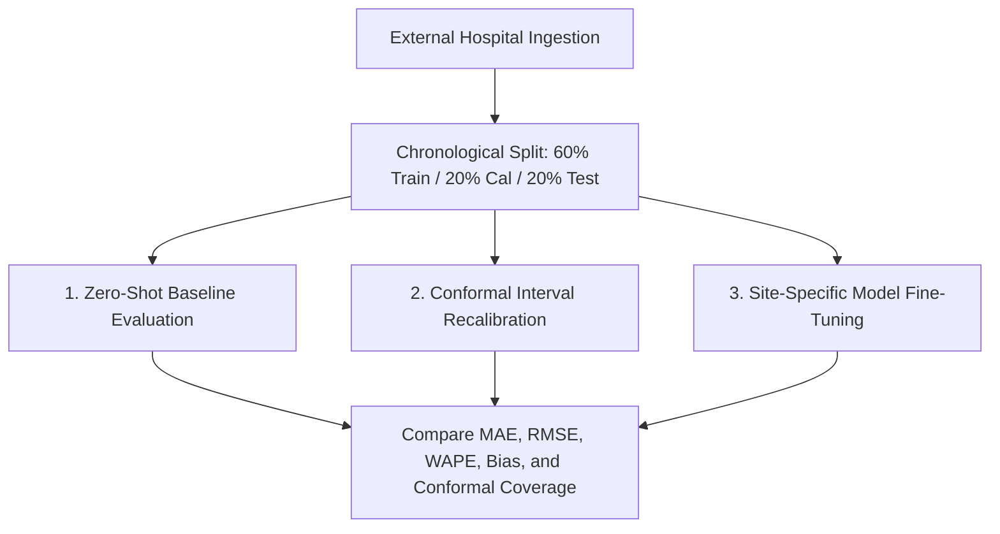

# VitalOptima External Dataset Validation & Multi-Center Transfer Plan

**Document Version:** 1.0.0  
**Status:** Approved Research Protocol  
**Author:** Independent Multidisciplinary Research Evaluation Team  

---

## 1. Scientific Motivation & The Multi-Center Generalization Problem

VitalOptima's baseline time-series forecaster and resource optimizer have been rigorously validated against a 365-day de-identified census time-series (`data/hospital_census_daily.csv`). However, machine learning models trained on a single hospital's operational profile inevitably learn site-specific characteristics:

1. **Hospital Topology & Scale:** An 800-bed urban Level-1 Trauma Center exhibits fundamentally different diurnal arrival volatility, trauma case mixes, and admission conversion ratios than a 150-bed suburban community facility or a 25-bed critical access rural hospital.
2. **Operational Policies:** Elective surgical block scheduling (e.g., concentrated Tuesday/Thursday schedules) and post-operative recovery bed holding policies induce site-specific autocorrelation.
3. **Payer & Social Demographics:** Regional epidemiological variations (e.g., seasonal respiratory syncytial virus spikes, extreme weather cold snaps, or localized industrial accidents) alter emergency department demand.

> [!WARNING]
> VitalOptima must **never** be assumed to generalize zero-shot to external hospitals without undergoing the formal multi-center cross-validation protocol defined below.

---

## 2. Target Benchmark Datasets for External Validation

To validate external generalizability without compromising patient privacy or fabricating synthetic multi-center data, the following three public and credentialed healthcare operations datasets have been selected:

### 2.1 MIMIC-IV-ED (PhysioNet)
- **Institution:** Beth Israel Deaconess Medical Center (Boston, MA, USA).
- **Access / License:** PhysioNet Credentialed Data Use Agreement (Requires CITI Human Subjects Training; de-identified under HIPAA Safe Harbor).
- **Temporal Granularity:** Minute-level timestamped patient arrivals, triage times, bed assignments, and transfer dispositions from 2011 to 2019 (>425,000 emergency department stays).
- **Target Mapping:**
  - `emergency_arrivals`: Aggregated hourly and daily counts of unique `stay_id` records in `edstays.csv`.
  - `admissions`: Filtered for `disposition = 'ADMITTED'` joined with inpatient admissions.
  - `icu_admissions`: Filtered for `transfer_to = 'ICU'`.

### 2.2 NHS England Accident & Emergency (A&E) Open Statistics
- **Institution:** National Health Service (NHS England, UK).
- **Access / License:** Open Government Licence v3.0 (Publicly accessible without credentialing).
- **Temporal Granularity:** Daily and weekly emergency department attendances and emergency admissions across 120+ NHS Acute Trusts.
- **Target Mapping:**
  - `emergency_arrivals`: Total Type 1 (Major ED) attendances.
  - `admissions`: Emergency admissions via A&E.
  - `bed_occupancy`: General & Acute bed occupancy percentage per Trust.

### 2.3 CDC National Syndromic Surveillance Program (NSSP)
- **Institution:** Centers for Disease Control and Prevention (USA).
- **Temporal Granularity:** Daily regional emergency department visit volume indexed by primary syndrome category (respiratory, gastrointestinal, trauma).

---

## 3. Standardized Cross-Dataset Schema & Ingestion Protocol

External data must be ingested through the standardized interface schema defined in `data/external_schema.json`:

| Canonical Field | Type | Unit / Format | Description |
| :--- | :--- | :--- | :--- |
| `date` | `string` | `YYYY-MM-DD` | Calendar date (UTC). |
| `hospital_id` | `string` | Alphanumeric | Anonymized facility identifier. |
| `hospital_type` | `string` | Categorical | `Level_1_Trauma`, `Community`, `Rural`. |
| `emergency_arrivals` | `integer` | Count | Total patients presenting to the emergency triage desk. |
| `admissions` | `integer` | Count | Patients admitted to inpatient staffed beds. |
| `icu_admissions` | `integer` | Count | Patients requiring immediate critical care beds. |
| `discharges` | `integer` | Count | Total inpatient discharges within the 24-hour cycle. |
| `general_beds_occupied`| `integer` | Count | Midnight inpatient census count. |
| `general_beds_total` | `integer` | Count | Licensed staffed physical beds. |

---

## 4. Multi-Center Evaluation Methodology

When external datasets are ingested, the evaluation pipeline will execute a three-tier comparison:

### 4.1 Tier 1: Zero-Shot Transfer Evaluation
Evaluate VitalOptima's baseline models (`Ridge` and `Random_Forest`) directly on the external hospital's untouched test set without weight modification.
- **Metric:** Transfer Degradation Ratio:
  $$\text{TDR} = \frac{\text{MAE}_{\text{external\_zeroshot}}}{\text{MAE}_{\text{internal\_baseline}}}$$
- An acceptable zero-shot transfer exhibits $\text{TDR} \le 1.35$.

### 4.2 Tier 2: Split Conformal Recalibration Protocol
Because mean arrival volumes shift across facilities, prediction intervals must be recalibrated.
- Using a 21-day calibration window from the target hospital, recompute the nonconformity quantile:
  $$\hat{q}_{\text{new}} = \text{Quantile}\left( \{ |y_t - \hat{y}_t| \}_{t \in \text{Cal}}, \frac{\lceil (n+1)(1-\alpha) \rceil}{n} \right)$$
- Verify whether the recalibrated interval restores empirical coverage to $\ge 88.0\%$ on the target hospital.

### 4.3 Tier 3: Distribution Shift Quantification
Compute the Population Stability Index (PSI) and Wasserstein Distance on the marginal arrival distribution:
$$\text{PSI} = \sum_{k=1}^K (P_k - Q_k) \ln\left( \frac{P_k}{Q_k} \right)$$
- $\text{PSI} < 0.10$: Minimal shift; models retain valid calibration.
- $0.10 \le \text{PSI} \le 0.25$: Moderate shift; requires feature scaling and recalibration.
- $\text{PSI} > 0.25$: Significant shift; full site-specific retraining required.

---

## 5. Regulatory & Deployment Boundary

Until credentialed multi-center clinical trials or live EHR integration pipelines are completed, VitalOptima's research outputs are officially designated as **Single-Center Retrospective Research Telemetry**. No claims of multi-center clinical clearance or FDA 510(k) exemption are made.
